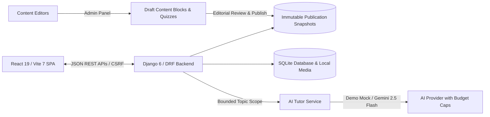

# Prepal

An academic, syllabus-driven study platform designed specifically for Rajasthan Administrative Services (RPSC / RAS) candidates. Prepal connects official curriculum topics with source-grounded study notes, archival source documents, untimed practice quizzes, and an AI study companion.

---

## Implemented Features

- **Full RPSC Syllabus Directory**: Complete 152-topic Prelims syllabus hierarchy covering Rajasthan History, Art, Culture, Geography, Economy, Polity, and General Science.
- **Source-Grounded Study Reader**: Semantic, distraction-free study notes with primary source citations and accessible typography.
- **Floating AI Study Tutor**: On-demand AI assistant widget with passage explanation ("Explain this passage"), topic-scoped context, token rate-limiting, and guest fallback.
- **Interactive Practice Quizzes**: Untimed, question-by-question mastery challenges with immediate explanations, source citations, and instant retries.
- **Student Authentication & Dashboard**: Per-user private bookmarks, syllabus completion progress tracking, and quiz performance analytics.
- **Primary Source & PDF Viewer**: Integrated canvas-based PDF reader for government gazettes, historical documents, and official acts.
- **Search & Filter**: Real-time topic search with typo suggestions and instant keyword filtering.
- **Light & Dark Themes**: System-adaptive and manually toggleable theme mode built with custom CSS design tokens.
- **Editorial Publication Workflow**: Django Admin interface supporting draft creation, rich content blocks, and immutable publication snapshots.

---

## Architecture



### Technology Stack

| Layer | Technologies |
| :--- | :--- |
| **Frontend** | React 19, Vite 7, React Router 7, DOMPurify, PDF.js, Vanilla CSS Design System |
| **Backend** | Python 3.14+, Django 6, Django REST Framework, SQLite |
| **Content Security** | nh3 HTML sanitizer, Pillow image validation, pypdf bounded extraction |
| **Testing** | Vitest 5, Playwright 1.64, Testing Library, Django Test Runner, ESLint 9 |
| **CI / CD** | GitHub Actions hermetic verification workflow |

---

## Getting Started

### Prerequisites

- **Node.js**: `24.x` (recommended via `nvm`)
- **Python**: `3.14.x` (or `3.12+`)
- **npm**: `11.x`

### 1. Clone & Install Dependencies

```bash
# Clone the repository
git clone git@github.com:KartikyaSokhal/RSPC-RAS-.git
cd RSPC-RAS-

# Install frontend dependencies
npm ci

# Set up Python virtual environment
python3 -m venv backend/.venv
source backend/.venv/bin/activate
pip install --require-hashes -r backend/requirements-dev.txt
```

### 2. Run the Development Demo

Prepal includes a non-destructive demo setup script that creates a self-contained SQLite database with synthetic curriculum fixtures:

```bash
# Initialize isolated demo database and fixtures
python scripts/prepare_demo.py

# Terminal 1: Start Django Backend (port 8000)
python backend/manage.py runserver 127.0.0.1:8000 --settings=core.demo_settings

# Terminal 2: Start Vite Frontend (port 5173)
npm run dev
```

Visit **http://localhost:5173** to explore the application.

---

## Django Content Management Studio

Administrative content management is available at **http://localhost:8000/admin/**.

### Content Structure & Workflow

1. **Topics (`Topic`)**: Add syllabus nodes. Set `parent` to create nested units/subtopics or leave blank for root categories.
2. **Content Blocks (`ContentBlock`)**: Attach structured text notes (semantic HTML) or diagrams directly to a topic.
3. **Practice Quizzes (`Quiz`, `Question`, `Choice`)**: Link multiple-choice questions to topics, complete with explanations and source references.
4. **Learning Resources (`LearningResource`)**: Upload official PDFs; the system automatically parses pages and creates searchable page records.
5. **Publication Workflow**:
   - Edits are saved as **Drafts**.
   - Review drafts using the **Preview draft** link.
   - To release notes publicly: Select topic(s) in Admin -> choose **"Publish selected topics after editorial review"** -> Click **Go**.
   - If needed, use **"Withdraw selected topics"** or **"Republish previous approved snapshot"** to rollback instantly.

---

## Testing & Quality Assurance

Every layer of Prepal is verified through automated test suites:

```bash
# Run all frontend static checks (ESLint, Vitest unit tests, Vite build)
npm run check

# Run Django backend unit and security test suite (62 tests)
cd backend && python run_tests.py && cd ..

# Run end-to-end browser tests in Chromium (Playwright)
npx playwright test

# Verify AI budget race condition and reservation locks
python scripts/verify_budget_race.py
```

---

## Repository Structure

```
├── src/                  # React 19 source code (pages, components, styles, hooks)
│   ├── api/              # Axios client with dynamic CSRF handling
│   ├── components/       # UI, study, AI companion, and layout components
│   ├── context/          # Authentication & theme context providers
│   ├── pages/            # Application routes (Home, Syllabus, Topic, Quiz, Dashboard)
│   └── styles/           # Modern CSS tokens, study layouts, and animations
├── backend/              # Django application
│   ├── content/          # Content models, publication services, DRF views, admin
│   ├── core/             # Django settings (production, demo, and test configurations)
│   └── run_tests.py      # Isolated test runner
├── e2e/                  # Playwright browser automation test specs
├── deploy/               # Production Nginx and Systemd service configurations
├── docs/                 # Public architecture, API, and deployment documentation
│   ├── ARCHITECTURE.md   # Architectural boundaries and component contracts
│   ├── API_DOCUMENTATION.md # REST API endpoint specifications
│   ├── DEPLOYMENT.md     # Production deployment instructions
│   └── CONTRIBUTING.md   # Contribution guidelines
├── public/               # Public application assets (prepal.svg)
└── package.json          # Frontend dependencies and automation scripts
```

---

## Security & AI Guardrails

- **DOMPurify & nh3 Sanitization**: All authored notes and AI outputs pass through strict HTML whitelists; executable scripts, iframes, and inline event handlers are stripped.
- **Topic-Scoped Retrieval**: AI tutor prompts are strictly bounded to the current lesson's published blocks and approved PDF page text.
- **Budget Reservations**: Atomic, micro-currency daily quotas prevent unexpected AI provider costs.
- **Stateless Quizzes**: Quiz answers are validated against cryptographically signed revision tokens, protecting answer keys from client-side tampering.

---

## Roadmap

- [ ] Interactive mains question answer-writing studio with word counter.
- [ ] Hindi language localization for Rajasthan regional candidates.
- [ ] Timed mock exam mode with simulated RPSC negative marking.
- [ ] Expanded archival primary document collection.

---

## License

All rights reserved. Educational and architectural materials prepared for RPSC / RAS preparation.
