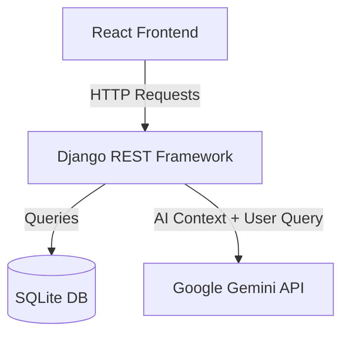
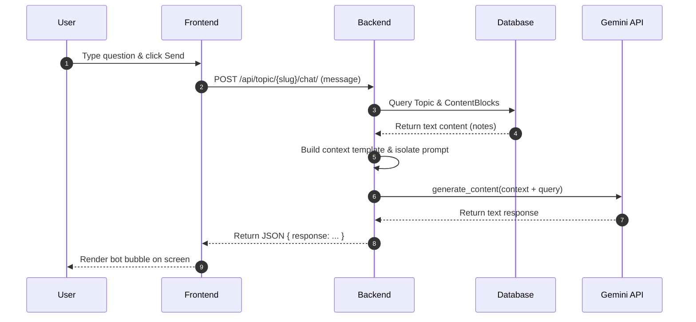
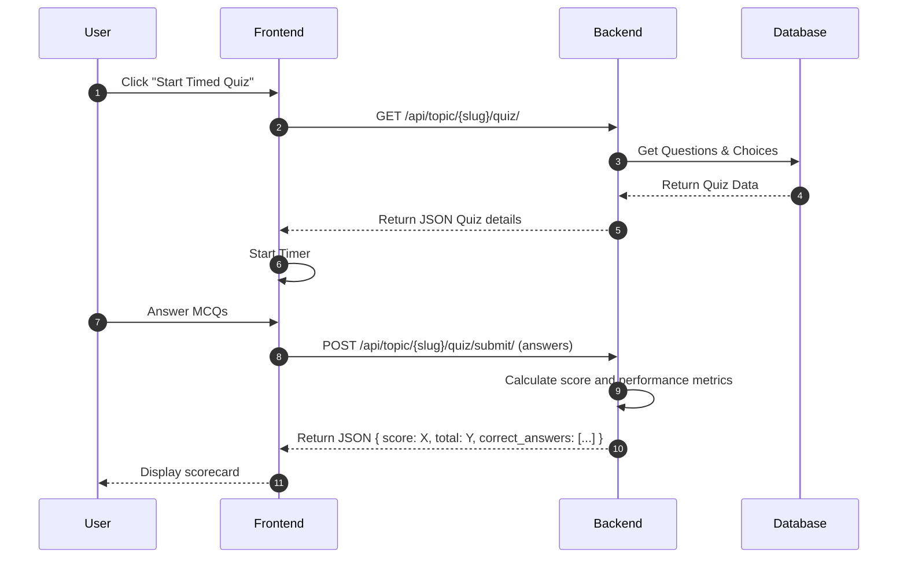

# Prepal AI - Architecture Reference

This document explains the architecture, data flow, and RAG integration for the Prepal AI platform.

---

## 1. System Overview

Prepal AI utilizes a decoupled client-server architecture. The frontend application fetches rendering data and interacts with services using REST endpoints.

---

## 2. Frontend Architecture
* **State Management:** Simple reactive React hooks (`useState`, `useEffect`).
* **Routing:** `react-router-dom` handles page paths (`/` for home, `/topic/:slug` for reading room, `/quiz/:slug` for testing).
* **Styling:** Modular CSS styled with modern custom properties (colors, typography, grid/flex layouts).

---

## 3. Backend Architecture
* **Routing & Controllers:** Django REST framework handles requests, executes custom RAG or quiz logic, and returns formatted JSON data.
* **Content Service:** Django Admin manages syllabus uploads. DB queries are highly optimized to fetch syllabus hierarchies efficiently.
* **AI Service (RAG):** The AI module is completely isolated in `ai_engine.py`. This ensures we can migrate to vector databases (like Vertex AI Vector Search) without changing view endpoints or API schemas.

---

## 4. RAG Chatbot Data Flow

When a user submits a question on a topic page, the RAG engine performs the following tasks:

---

## 5. Timed Quiz Flow

---

## 6. Future Scalability
* **Vector DB Integration:** If notes expand to thousands of pages, the query engine can easily switch to pgvector or Vertex AI, using embeddings to retrieve the top 3-5 most relevant chunks.
* **Model Upgrades:** The isolated `ai_engine.py` allows upgrading models (e.g. from `gemini-2.5-flash` to advanced reasoning models) with a single string replacement.
* **Caching Layer:** Introduce Redis to cache RAG contexts and repeat questions, reducing latency and api costs.
